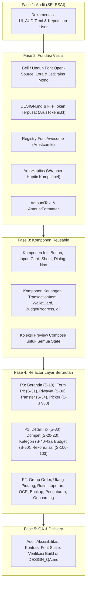

# Arus: UI & UX Design System Audit (Fase 1)

**Tanggal:** 6 November 2026  
**Status:** Selesai (Menunggu Persetujuan untuk Fase 2)  
**Dokumen Acuan:** `docs/design-system/arus-design-system-plan-v2.md`, `arus-user-flow.md`, `arus-erd.md`, `wireframes/*.dc.html`  

---

## 1. Arsitektur UI Saat Ini

### 1.1 Struktur Modul & Konfigurasi Gradle
- **Struktur Proyek:** Single-module (`:app`).
- **Build & SDK:**
  - Android Gradle Plugin: `9.2.1`
  - Kotlin / Compose Plugin: `2.3.20`
  - `compileSdk`: `37`
  - `targetSdk`: `37`
  - `minSdk`: `26`
- **Compose UI Stack:**
  - `androidx.compose.ui:ui:1.12.0`
  - `androidx.compose.foundation:foundation:1.12.0`
  - `androidx.compose.animation:animation:1.12.1`
  - `androidx.compose.ui:ui-tooling-preview:1.12.1`
  - `androidx.paging:paging-compose:3.4.1`
  - **Catatan Penting:** Proyek **tidak menggunakan Material 3** (`androidx.compose.material3`). Semua komponen UI dibangun langsung di atas primitif `androidx.compose.foundation` (`BasicText`, `BasicTextField`, `Box`, `Column`, `Row`, `Canvas`, `clickable`).

### 1.2 Navigasi
- Proyek **tidak menggunakan Jetpack Navigation Compose** (`androidx.navigation:navigation-compose`).
- Navigasi diatur secara manual di dalam `MainActivity.kt` menggunakan satu mutable state string:
  ```kotlin
  var selectedDestination by rememberSaveable { mutableStateOf("Beranda") }
  ```
- Layar-layar sub-fitur atau dialog dibuka dengan conditional flag (`var transferOpen`, `var transactionType`, `var historySelected`, dll.).
- **Bottom Navigation saat ini:**
  - Menampilkan 6 item teks flat: `["Beranda", "Riwayat", "Dompet", "Anggaran", "Laporan", "Lainnya"]` (atau mengganti "Riwayat" dengan "Checkpoint" bila dalam mode rekonsiliasi).
  - **Tidak ada FAB (+) melayang** di tengah seperti yang dispesifikasikan pada wireframe `S-00a`.
  - Bottom navigation tetap muncul di layar sub-halaman (seperti Anggaran & Laporan), dengan tombol anomali `"‹ Kembali"` melayang di atas bottom navigation bar (`MainActivity.kt:516-518`).

### 1.3 State Management & Arsitektur Data
- **Tidak ada ViewModel AAC atau Hilt.**
- Setiap Composable screen mengelola state internalnya menggunakan `remember`, `rememberSaveable`, `mutableStateOf`, `mutableStateListOf`, dan memanggil Room DAO langsung dari `LaunchedEffect` atau coroutine scope via `withContext(Dispatchers.IO)`.
- Mengingat batasan **Batasan 7: "Jangan ganti ViewModel tanpa alasan teknis yang sah"**, pola state holder dan kontrak IO ini harus dipertahankan saat refactor visual dilakukan.

### 1.4 Status Design System & Token Saat Ini (`ui/designsystem/`)
Terdapat implementasi awal semi-vibe-coded di package `com.illustravibes.arus.ui.designsystem`:
- `ArusTokens.kt`: Hanya mendefinisikan `ArusRadius` (Small 6dp, Medium 8dp, Large 12dp, ExtraLarge 14dp) dan `ArusSpacing` (4, 8, 12, 16, 24, 32dp). **Tidak sesuai dengan plan v2** (Pill, Input 18dp, Card 24dp, Sheet/Dialog 28dp).
- `ArusTheme.kt`:
  - `primary` diset ke `Color(0xFF27272A)` (zinc-800 gelap) dan bukannya brand blue `#0009FF`.
  - Tidak ada token semantik (`income #16A34A`, `incomeText #15803D`, `expense #DC2626`, `warning #D97706`, `warningText #B45309`, `info #0009FF`, `errorSurface`).
  - Skala warna Tailwind Zinc tidak lengkap/tidak terpusat.
- `ArusText.kt`: Pembungkus `BasicText` sederhana.
- `ArusIcon.kt`:
  - Menggunakan font `font_awesome_solid.ttf` dari `res/font/`.
  - Menggunakan enum `ArusIconCode` berbasis hardcoded codepoint hexadecimal (`0xF015`), bukan string key registry yang stabil.
  - Parameter `contentDescription` diabaikan sepenuhnya (tidak ada semantic accessibility).
- `ArusComponents.kt`:
  - `ArusButton`: Tinggi minimum 44dp (melanggar standar touch target ≥ 48dp).
  - `ArusCheckbox`: Ukuran 24dp tanpa padding sentuh (melanggar standar ≥ 48dp).
  - `ArusTextField`: Tinggi minimum 42dp (melanggar standar ≥ 48dp).
  - Belum ada Compose Preview sama sekali.

### 1.5 Aset Font di `app/src/main/res/font/`
- `font_awesome_solid.ttf` (426 KB): **Font Awesome 6 Free Solid (Version 6.7.2)**, lisensi SIL Open Font License 1.1.
- `plus_jakarta_sans.ttf` (176 KB): **Plus Jakarta Sans Regular (Version 2.071)**, lisensi SIL Open Font License 1.1.
- **Font Hilang:**
  - **Lora** (belum ada file font sama sekali di proyek).
  - **Mono** (Consolas equivalent seperti JetBrains Mono / Inconsolata belum ada sama sekali).
  - Varian berat Plus Jakarta Sans (Medium, SemiBold, Bold) belum memiliki berkas TTF tersendiri (saat ini single regular TTF dipetakan ke semua weight).

---

## 2. Inventaris Layar (Dipetakan ke Kode `S-xx`)

Total layar pada wireframe: **74 berkas wireframe (`.dc.html`)**. Berikut audit status implementasi setiap layar dalam kode aplikasi:

| Kode | Nama Layar di User Flow / Wireframe | Wireframe File | Status di Kode Saat Ini | Lokasi Implementasi Kode & Catatan Audit |
|---|---|---|---|---|
| **S-01** | Splash + Kunci aplikasi (PIN/biometrik) | `Kunci.dc.html` | ✅ Ada | `MainActivity.kt:1968` (`AppLockScreen`), `AppLock.kt`. Diimplementasikan sebagai Dialog kaku tanpa Lora/marker illustration. |
| **S-02** | Onboarding: Sambutan singkat | `Sambutan.dc.html` | ⚠️ Parsial | `MainActivity.kt:2220` (`Onboarding` step 0). Teks Plus Jakarta Sans biasa, tanpa Lora, ilustrasi hanya icon dompet 36sp di dalam box. |
| **S-03** | Onboarding: Setup dompet pertama | `SetupDompet.dc.html` | ✅ Ada | `MainActivity.kt:2243` (`Onboarding` step 1). Preset dimuat dari JSON, layout berjejal. |
| **S-03a** | Onboarding: Periode keuangan | `Periode.dc.html` | ⚠️ Di Pengaturan | Tidak muncul di flow onboarding awal; hanya dapat diatur di `AppSettingsManagement.kt:87`. |
| **S-04** | Onboarding: Pilih kategori bawaan | `PilihKategori.dc.html` | ✅ Ada | `MainActivity.kt:2290` (`Onboarding` step 2). Berupa flow chip sederhana. |
| **S-05** | Atur PIN dan biometrik | `PIN.dc.html` | ✅ Ada | `MainActivity.kt:1946` (`PinSetupDialog`) & step 3 onboarding. Menggunakan Dialog modal alih-alih keypad PIN khusus. |
| **S-06** | Pulihkan dari backup (onboarding) | `Pulihkan.dc.html` | ✅ Ada | `MainActivity.kt:251` (membuka `BackupRestoreManagement`). |
| **S-10** | Beranda (Home Overview) | `Main.dc.html` | ⚠️ Vibe-coded | `MainActivity.kt:552` (`HomeOverview`). Kartu Net worth abu-abu, wallet list row kaku, tombol quick action ditaruh di dalam list. Tidak ada floating (+) FAB. |
| **S-00a** | Menu Tambah (+) FAB Sheet | `MenuTambah.dc.html` | ❌ Belum Ada | FAB (+) tengah di bottom nav tidak ada. Tombol aksi cepat dipasang sebagai 3 tombol biasa di dalam kartu HomeOverview. |
| **S-11** | Rincian Net Worth | `NetWorth.dc.html` | ⚠️ Salah Bentuk | `MainActivity.kt:679`. Diimplementasikan sebagai `ArusDialog` kecil, bukan layar penuh / sheet rincian aset & kewajiban seperti wireframe. |
| **S-12** | Tugas Tertunda (Inbox) | `Tugas.dc.html` | ❌ Belum Ada | Tidak ada inbox terpusat di Beranda. Recurring occurrences hanya terlihat di dalam menu Rutin. |
| **S-20** | Daftar Dompet | `Dompet.dc.html` | ✅ Ada | `MainActivity.kt:1174` (`WalletManagement`). Pengurutan menggunakan tombol teks "Naik" & "Turun" manual. |
| **S-21** | Form Dompet (Bank/E-Wallet/Tunai) | `FormDompet.dc.html` | ⚠️ Salah Bentuk | `MainActivity.kt:1843` (`WalletFormDialog`). Menggunakan Dialog bertumpuk alih-alih layar form. |
| **S-21a** | Form Dompet Kredit | `FormKredit.dc.html` | ⚠️ Parsial | Digabung ke `WalletFormDialog` secara kondisional jika tipe Kredit dipilih. |
| **S-22** | Detail Dompet | `DetailDompet.dc.html` | ⚠️ Salah Bentuk | `MainActivity.kt:1261`. Dibuka sebagai `ArusDialog` sempit dengan scroll internal, bukan layar detail penuh. |
| **S-22a** | Detail Dompet Kredit | `DetailKredit.dc.html` | ⚠️ Parsial | Digabung dalam text summary di dialog detail dompet tanpa visual batas limit. |
| **S-23** | Dompet Terarsip | `Terarsip.dc.html` | ✅ Ada | `MainActivity.kt:1205`. Toggle state `showArchived` di dalam daftar dompet. |
| **S-30** | Riwayat Transaksi | `Riwayat.dc.html` | ⚠️ Vibe-coded | `MainActivity.kt:831` (`TransactionHistory`). Menggabungkan form filter masif langsung di atas list transaksi. Nominal tidak pakai font Mono. |
| **S-31** | Form Transaksi (Pengeluaran/Pemasukan) | `Pengeluaran.dc.html` | ⚠️ Salah Bentuk | `MainActivity.kt:1396` (`TransactionQuickEntry`). Diimplementasikan sebagai `Dialog` modal dengan tombol Simpan di dalam dialog, bukan layar penuh dengan keyboard pinning. |
| **S-32** | Form Split Kategori | `Split.dc.html` | ⚠️ Salah Bentuk | `MainActivity.kt:1642`. Diimplementasikan sebagai dialog modal bersarang di atas dialog QuickEntry. |
| **S-32a** | Tambah Baris Split | `SplitSheet.dc.html` | ⚠️ Parsial | Menambah row inline di dalam dialog split tanpa sheet terpisah. |
| **S-33** | Detail Transaksi | `DetailTrx.dc.html` | ⚠️ Salah Bentuk | `MainActivity.kt:1043` (`TransactionDetails`). Berupa `Dialog`. Tombol Edit membuka dialog ketiga di atas dialog ini! |
| **S-33a** | Detail Pembayaran Group Order | `DetailTrxGO.dc.html` | ⚠️ Parsial | Menggunakan tampilan detail transaksi umum dengan info teks catatan tambahan. |
| **S-33b** | Peringatan Terverifikasi | `DialogVerif.dc.html` | ✅ Ada | Ditampilkan sebagai teks peringatan inline sebelum edit/hapus transaksi. |
| **S-34** | Form Transfer | `Transfer.dc.html` | ⚠️ Salah Bentuk | `MainActivity.kt:1300` (`TransferEntry`). Berupa modal `Dialog`. Menampilkan seluruh dompet sebagai tombol bertumpuk (bisa puluhan tombol jika dompet banyak). |
| **S-35** | Template Transfer | `Template.dc.html` | ⚠️ Parsial | Hanya berupa 3 tombol tab template di form transfer, belum ada alur step transfer tarik tunai lengkap. |
| **S-36** | Pencarian & Filter | `Cari.dc.html` | ⚠️ Parsial | Berjejal langsung di bagian atas daftar Riwayat Transaksi (`MainActivity.kt:951-985`). |
| **S-37** | Pilih Kategori (Picker) | `PilihKat.dc.html` | ⚠️ Salah Bentuk | `MainActivity.kt:1632`. Berupa `ArusDialog` modal, bukan bottom sheet dengan fitur pencarian. |
| **S-38** | Pilih Dompet (Picker) | `PilihDompet.dc.html` | ⚠️ Salah Bentuk | `MainActivity.kt:1623`. Berupa `ArusDialog` modal, bukan bottom sheet. |
| **S-40** | Daftar Kategori | `Kategori.dc.html` | ⚠️ Vibe-coded | `MainActivity.kt:1995` (`CategoryManagement`). Menggunakan icon titik tiga (`⋮`) dan popup dropdown menu (melanggar aturan layout global). |
| **S-41** | Form Kategori | `FormKategori.dc.html` | ⚠️ Vibe-coded | `MainActivity.kt:2158` (`CategoryFormDialog`). **Pengguna harus mengetik nama string icon dan kode hex ARGB secara manual di text field!** |
| **S-42** | Dialog Hapus Kategori | `HapusKat.dc.html` | ✅ Ada | `MainActivity.kt:2111` (`deleteSource` dialog). Logika pemindahan transaksi berjalan baik. |
| **S-50** | Anggaran (Progress & Total) | `Anggaran.dc.html` | ✅ Ada | `BudgetManagement.kt:80`. Berfungsi, namun progress bar digambar dengan Canvas dan warna mentah `#E8E8E8`/`#B8BEC4`. |
| **S-51** | Form Budget | `FormBudget.dc.html` | ⚠️ Parsial | Tampil inline saat tombol Tambah diklik di dalam `BudgetManagement.kt:96`, bukan sheet/layar tersendiri. |
| **S-52** | Laporan (Pie, Tren, Masuk vs Keluar) | `Laporan.dc.html` | ✅ Ada | `ReportScreen.kt:76`. Diagram lingkaran digambar di Canvas dengan palet warna mentah. |
| **S-53** | Detail Kategori pada Periode | `DetailKat.dc.html` | ⚠️ Salah Bentuk | `ReportScreen.kt:140`. Berupa modal `ArusDialog`, bukan layar penuh. |
| **S-60** | Daftar Aturan Rutin | `DaftarRutin.dc.html` | ✅ Ada | `RecurringManagement.kt:251`. |
| **S-61** | Form Aturan Rutin | `FormRutin.dc.html` | ⚠️ Parsial | Form input ditaruh langsung inline di atas daftar rutin. |
| **S-62** | Konfirmasi Transaksi Rutin | `KonfirmasiRutin.dc.html` | ✅ Ada | `RecurringManagement.kt:238`. Dialog ubah nominal baris 285. |
| **S-63** | Pengaturan Reminder | `Reminder.dc.html` | ✅ Ada | Ditaruh sebagai kartu di bagian atas `RecurringManagement.kt:160`. |
| **S-70** | Daftar Kontak | `Kontak.dc.html` | ⚠️ Parsial | Kontak ditampilkan sebagai pengelompokan di dalam `DebtManagement.kt:85`. |
| **S-70a** | Form Kontak | `FormKontak.dc.html` | ❌ Belum Ada | Kontak dibuat implisit saat menambah utang (mengetik nama baru). |
| **S-71** | Detail Kontak | `DetailKontak.dc.html` | ⚠️ Salah Bentuk | `DebtManagement.kt:150`. Dibuka sebagai modal `ArusDialog`. |
| **S-72** | Daftar Utang-Piutang | `UtangPiutang.dc.html` | ✅ Ada | `DebtManagement.kt:41`. |
| **S-72a** | Detail Piutang | `DetailUtang.dc.html` | ⚠️ Parsial | Tampil inline di dalam kartu kontak pada `DebtManagement.kt`. |
| **S-73** | Form Utang-Piutang | `FormUtang.dc.html` | ⚠️ Salah Bentuk | `DebtManagement.kt:130` (`AddDebtDialog`). Modal dialog. |
| **S-74** | Catat Pelunasan Piutang | `Pelunasan.dc.html` | ⚠️ Salah Bentuk | `DebtManagement.kt:261` (`DebtSettlementDialog`). Modal dialog. |
| **S-74a** | Bayar Utang | `BayarUtang.dc.html` | ⚠️ Salah Bentuk | Digabung di `DebtSettlementDialog` untuk arah `BORROWED`. |
| **S-75** | Dialog Selisih Pelunasan | `DialogSelisih.dc.html` | ⚠️ Parsial | Ditampilkan sebagai teks kelebihan di dalam dialog pelunasan. |
| **S-80** | Daftar Group Order | `DaftarGO.dc.html` | ✅ Ada | `GroupOrderManagement.kt:149`. |
| **S-81** | Wizard 1: Info Order | `GOInfo.dc.html` | ✅ Ada | `GroupOrderManagement.kt:212` (Step 1). |
| **S-82** | Wizard 2: Peserta | `GOPeserta.dc.html` | ✅ Ada | `GroupOrderManagement.kt:256` (Step 2). |
| **S-83** | Wizard 3: Item & Pemilik | `GOItem.dc.html` | ✅ Ada | `GroupOrderManagement.kt:296` (Step 3). |
| **S-83a** | Sheet Item Group Order | `SheetItem.dc.html` | ⚠️ Parsial | Form item ditampilkan inline di dalam Step 3. |
| **S-84** | Wizard 4: Biaya Bersama & Diskon | `GOBiaya.dc.html` | ✅ Ada | `GroupOrderManagement.kt:361` (Step 4). |
| **S-85** | Wizard 5: Tinjau Hasil Hitung | `GroupOrder.dc.html` | ✅ Ada | `GroupOrderManagement.kt:421` (Step 5). |
| **S-86** | Detail Group Order | `DetailGO.dc.html` | ✅ Ada | `GroupOrderManagement.kt:472`. |
| **S-87** | Bagikan Tagihan | `Bagikan.dc.html` | ✅ Ada | `GroupOrderManagement.kt:615` (Format pesan teks via Intent SEND). |
| **S-90** | Kamera / Galeri (OCR) | `Kamera.dc.html` | ✅ Ada | `ReceiptScanner.kt:77` (CameraX + photo picker). |
| **S-91** | Crop dan Rotate (OCR) | `Crop.dc.html` | ✅ Ada | `ReceiptScanner.kt:180` (`ReceiptCropCanvas`). |
| **S-92** | Hasil OCR → Konfirmasi Transaksi | `OCR.dc.html` | ✅ Ada | `ReceiptScanner.kt` + `TransactionQuickEntry` (`initialReceipt`). |
| **S-93** | Hasil OCR → Group Order | `OCRGO.dc.html` | ✅ Ada | `ReceiptOcrGroupOrderImporter.kt`. |
| **S-100** | Cocokkan Saldo: Input Saldo Asli | `InputSaldo.dc.html` | ⚠️ Salah Bentuk | `MainActivity.kt:690`. Dimasukkan ke dalam satu raksasa dialog rekonsiliasi di HomeOverview. |
| **S-101** | Cocokkan Saldo: Hasil Selisih | `Cocokkan.dc.html` | ⚠️ Salah Bentuk | `MainActivity.kt:766`. Inline di dalam dialog rekonsiliasi. |
| **S-102** | Mode Cek Mutasi | `CekMutasi.dc.html` | ⚠️ Salah Bentuk | `MainActivity.kt:707`. Expandable section inline di dalam dialog rekonsiliasi. |
| **S-103** | Resolusi Selisih | `Resolusi.dc.html` | ⚠️ Salah Bentuk | `MainActivity.kt:770`. Inline di dalam dialog rekonsiliasi. |
| **S-104** | Riwayat Rekonsiliasi & Kebocoran | `RiwayatRekon.dc.html` | ✅ Ada | `CheckpointHistory.kt:36`. Termasuk grafik batang bulanan di Canvas. |
| **S-105** | Hitung Pecahan Uang Tunai | `Pecahan.dc.html` | ⚠️ Salah Bentuk | `MainActivity.kt:733`. Bagian tersembunyi inline di dalam dialog rekonsiliasi. |
| **S-110** | Pengaturan (Tema, Bahasa, Periode) | `Pengaturan.dc.html` | ✅ Ada | `AppSettingsManagement.kt:41`. |
| **S-111** | Keamanan (PIN, Biometrik) | `Keamanan.dc.html` | ✅ Ada | `MainActivity.kt:1920` (`AppLockSettings`). |
| **S-112** | Backup & Restore | `Backup.dc.html` | ✅ Ada | `BackupRestoreManagement.kt:46`. |
| **S-113** | Export (CSV/Excel/PDF) | `Export.dc.html` | ✅ Ada | `ExportDataManagement.kt:42`. |
| **S-114** | Izin & Notifikasi | `Izin.dc.html` | ⚠️ Parsial | Digabung di dalam `RecurringManagement.kt:183`. |
| **S-00** | Hub Menu "Lainnya" | `Lainnya.dc.html` | ⚠️ Vibe-coded | `MainActivity.kt:420`. Hanya berupa kolom tombol vertikal polos. |

---

## 3. Masalah Visual & Pelanggaran Aturan Utama

### 3.1 Nilai Warna dan Radius Mentah (Hardcoded Tokens)
- `BudgetManagement.kt` (lines 157, 159): `Color(0xFFE8E8E8)` dan `Color(0xFFB8BEC4)` digambar langsung pada Canvas.
- `ReportScreen.kt` (lines 110, 175, 177): `Color(0xFFB8BEC4)`, `Color(0xFFD3E6FA)`, `Color(0xFFE8E8E8)` digunakan untuk pie chart dan progress.
- `MainActivity.kt` (lines 1890, 2281): Fallback warna hex `0xFF607D8B.toInt()` disimpan ke database.
- `MainActivity.kt` (line 2235): `Box(Modifier.size(8.dp).background(..., RoundedCornerShape(50)))` — nilai radius mentah tanpa token.
- `MainActivity.kt` (line 2215): `RoundedCornerShape(4.dp)`.

### 3.2 Typography & Lisensi Font
1. **Consolas / Mono:** Tidak ada font monospace yang dibundel di proyek. Semua angka keuangan saat ini menggunakan Plus Jakarta Sans proporsional, sehingga angka di tabel/riwayat tidak rata digit (tabular).
2. **Lora Editorial:** Font Lora belum terpasang sama sekali. Judul onboarding, ucapan selamat datang, dan empty state saat ini memakai font sans generic yang terasa kaku dan datar.
3. **Plus Jakarta Sans Weights:** Hanya ada satu file `plus_jakarta_sans.ttf` di `res/font/`, namun di `ArusTheme.kt` dipetakan ke Normal, Medium, SemiBold, dan Bold sekaligus (mengandalkan synthetic bolding dari OS).

### 3.3 Pelanggaran Bentuk dan Spasi
- Token radius di `ArusTokens.kt` saat ini: `Small 6dp`, `Medium 8dp`, `Large 12dp`, `ExtraLarge 14dp`.
- **Rencana v2 mewajibkan:**
  - `pill`: Bulat penuh (`CircleShape`) untuk tombol, chip, filter, tab segmen, badge.
  - `input`: `18dp` untuk text field dan input nominal.
  - `card`: `24dp` untuk kartu data.
  - `sheet` / `dialog`: `28dp` untuk bottom sheet dan dialog.
- Saat ini tombol menggunakan radius 12dp/8dp bukan pill; text field menggunakan 8dp bukan 18dp; card menggunakan 12dp bukan 24dp.
- Spasi acak tersebar: `padding(horizontal = 20.dp, vertical = 16.dp)`, `spacedBy(6.dp)`, `spacedBy(10.dp)`, `spacedBy(14.dp)` alih-alih kelipatan sistem 4, 8, 12, 16, 20, 24, 32, 40dp.

### 3.4 Ikon Campuran & Kelemahan Font Awesome
- Kategori bawaan di `assets/categories.json` menyimpan string nama ikon **Material** (`restaurant`, `directions_bus`, `local_gas_station`, `shopping_bag`, dll.).
- `ArusIcon.kt` melakukan translasi manual berbasis hardcoded enum `ArusIconCode`.
- Preset dompet di `assets/wallet-presets.json` menyimpan inisial karakter satu huruf (`B`, `M`, `S`) atau nama icon Material (`payments`, `savings`).
- `ArusIcon` mengabaikan parameter `contentDescription` sepenuhnya, sehingga seluruh ikon aplikasi tidak terbaca oleh screen reader (TalkBack).
- Ukuran ikon bervariasi acak (14sp, 18sp, 36sp) alih-alih token 16dp, 20dp, 24dp.

### 3.5 Masalah Layout & Struktur Terhadap Wireframe
1. **Epidemi Modal Dialog (Anti-Pattern):**
   - Layar input utama seperti Form Transaksi (`S-31`), Form Transfer (`S-34`), Detail Transaksi (`S-33`), Form Dompet (`S-21`), dan seluruh rangkaian Rekonsiliasi (`S-100` s/d `S-105`) diimplementasikan sebagai popup **`Dialog`**.
   - Pengguna mengalami *dialog fatigue* dan dialog bersarang (dialog di atas dialog). Pada wireframe, layar-layar ini adalah layar penuh (`Activity`/`Scene`) atau `BottomSheet` elegan.
2. **Kartu Bersarang (Nested Cards):**
   - Di `CheckpointHistory.kt:113-121`, terdapat `ArusCard` (rata-rata tak terlacak) di dalam `ArusCard` utama (grafik tak terlacak). Ini melanggar aturan: *"Tanpa kartu bersarang"*.
3. **Menu Titik Tiga (Overflow Menu `⋮`):**
   - Di `MainActivity.kt:2040-2041` (`CategoryManagement`), item kategori menggunakan icon titik tiga dan dropdown menu. Ini melanggar aturan wireframe: *"Layar detail tanpa menu ⋮. Satu aksi utama per layar berupa tombol pill di bawah"*.
4. **Form Kategori Vibe-Coded Ekstrem:**
   - Di `CategoryFormDialog` (`MainActivity.kt:2175-2176`), pengguna diminta mengetik kode warna hex (`FF9E9E9E`) dan nama string ikon secara manual di text field. Wireframe `S-41` (`FormKategori.dc.html`) memiliki grid pemilih warna dan grid pemilih ikon Font Awesome yang siap sentuh.
5. **Touch Target Size (< 48dp):**
   - `ArusCheckbox` (24dp), `ArusButton` (tinggi minimum 44dp), `ArusTextField` (tinggi minimum 42dp). Semuanya melanggar ambang batas aksesibilitas Android (minimum 48×48dp).

---

## 4. Duplikasi Komponen

| Komponen / Fungsionalitas | Duplikasi Ditemukan di Kode | Dampak Visual & Solusi |
|---|---|---|
| **Pemformat Nominal Rupiah** | `ArusFormatting.formatRupiah(amount)` dipanggil acak di 10+ file; text formatting dicampur manual di `HomeOverview`, `TransactionHistory`, `BudgetManagement`, `DebtManagement`, `ReportScreen`. | Tidak ada keseragaman font (Mono vs Sans), tanda minus sering hilang pada pengeluaran, transfer kadang berwarna salah. **Solusi:** Ganti total dengan satu komponen terpusat `AmountText(amount, type, style)`. |
| **Transaction Item Row** | Diimplementasikan manual 6 kali: di `HomeOverview:655`, `TransactionHistory:1009`, `TransactionDetails:1078`, `BudgetManagement:162`, `ReportScreen:152`, dan `CheckpointHistory:131`. | Layout baris transaksi tidak konsisten, ikon kategori sering tidak muncul, badge terverifikasi dan tanggal berbeda-beda. **Solusi:** Satukan ke `TransactionItem`. |
| **Wallet Card & Item** | Diimplementasikan manual di `HomeOverview:621` (kartu carousel mini), `WalletManagement:1221` (kartu daftar), `TransferEntry:1341` (tombol pilihan), dan `Onboarding:2255`. | Visual tipe dompet (Bank vs E-Wallet vs Tunai vs Kredit) dan saldo berbeda-beda. **Solusi:** Buat `WalletCard` dan `WalletCarousel`. |
| **Progress Bar / Visual Meter** | Digambar manual via Canvas di `BudgetManagement:156` dan `ReportScreen:174`. | Warna dan radius tidak sinkron. **Solusi:** Buat `BudgetProgress` yang otomatis berubah warna saat normal, 80% (kuning/warning), dan terlampaui (merah). |
| **Empty State & Error State** | Ditulis ad-hoc dengan `ArusCard` + teks polos di setiap file jika data kosong. | Terasa sepi dan mati, tanpa ilustrasi spidol dan tanpa tipografi editorial Lora. **Solusi:** Satukan ke `ArusEmptyState` dan `ArusErrorState`. |
| **Dialog Konfirmasi Hapus** | Diulang terpisah di Transaksi (`MainActivity.kt:1123`), Dompet (`MainActivity.kt:1250`), Kategori (`MainActivity.kt:2117`), dan Rutin. | **Solusi:** Gunakan wrapper `ArusDialog` terstandarisasi dengan tipe destruktif dan feedback yang jelas. |

---

## 5. Strategi Refactor yang Direkomendasikan

Refactor dilakukan bertahap tanpa menyentuh logika Room / Database / DAO / perhitungan bisnis.



### Langkah Eksekusi Refactor:
1. **Fondasi (Fase 2):**
   - Tambahkan berkas font ke `res/font/`:
     - `lora_regular.ttf`, `lora_semibold.ttf`, `lora_italic.ttf`
     - `jetbrains_mono_regular.ttf`, `jetbrains_mono_medium.ttf` (atau Inconsolata)
     - `plus_jakarta_sans_medium.ttf`, `plus_jakarta_sans_semibold.ttf`, `plus_jakarta_sans_bold.ttf`
   - Kunci token warna, bentuk (pill, 18, 24, 28dp), elevasi nol, spasi (4-40dp).
   - Implementasikan `ArusHaptics` dengan fallback `VibrationEffect` untuk API level lama dan toggle di Settings.
   - Perbaiki `ArusIcon` menjadi `(key: String, size: Dp, contentDescription: String?)` dengan kamus pemetaan backward-compatible dari string kategori lama ke Font Awesome glyph.
2. **Komponen (Fase 3):**
   - Bangun komponen umum dan domain keuangan dengan Compose Preview interaktif (Normal, Pressed, Disabled, Error).
   - Pastikan area sentuh minimum 48×48dp terpenuhi di semua tombol, chip, dan input.
3. **Pemisahan Layar (Fase 4):**
   - Pecah `MainActivity.kt` yang saat ini mencapai 2.351 baris menjadi berkas layar terpisah di package `ui/screens/` (misal: `HomeScreen.kt`, `TransactionHistoryScreen.kt`, `TransactionFormScreen.kt`, `WalletScreen.kt`, dll.).
   - Ganti modal dialog input dengan `ArusBottomSheet` atau layar penuh sesuai target wireframe.
   - Sempurnakan bottom navigation: 4 tab akar + tombol FAB (+) tengah melayang yang memicu sheet 6 aksi cepat (`MenuTambah.dc.html`).

---

## 6. Dependensi yang Sebaiknya Dipakai Ulang

1. **Jetpack Compose Foundation & Animation (Versi `1.12.0` / `1.12.1`):**
   - Sudah sangat stabil dan kompatibel dengan Kotlin 2.3.20.
   - **Rekomendasi:** **Tetap jangan menambahkan Material 3.** Mempertahankan design system berbasis Compose Foundation kustom menjaga aplikasi tetap ringan, kontrol token 100% presisi, dan bebas dari default styling Material yang berbenturan dengan karakter Arus.
2. **Font Awesome 6 Free Solid (`res/font/font_awesome_solid.ttf`):**
   - Font file sudah tersemat (426 KB).
   - Menyediakan ribuan glyph solid yang mencakup seluruh kebutuhan keuangan, kategori, navigasi, dan utilitas.
   - Cukup buat registry pemetaan string key ke unicode codepoint tanpa perlu menambah library eksternal.
3. **ML Kit Text Recognition & CameraX:**
   - Pipeline OCR di `ReceiptScanner.kt` sudah bekerja. Cukup perbaiki UI kamera, crop canvas, dan hasil review form agar sesuai token Arus.
4. **Room Database, Paging Compose, Biometric, SQLCipher:**
   - Pertahankan seluruhnya tanpa perubahan dependensi.

---

## 7. Risiko dan Batasan Arsitektur

1. **Keterikatan State Composable Tanpa ViewModel:**
   - Karena layar tidak memiliki AAC ViewModel independen, state navigasi dan data di-hoist di Composable level atas.
   - *Mitigasi:* Saat memecah file layar dari `MainActivity.kt`, pertahankan interface callback (`onSave`, `onDismiss`, `onNavigate`) dan passing instance database / DAO tanpa mengubah siklus hidup data.
2. **Kontrak UI Test (`androidTest`):**
   - Terdapat pengujian UI di `app/src/androidTest/` (seperti `TransactionQuickEntryTest.kt`) yang memeriksa `testTag` tertentu (`home_overview_list`, `actual_balance_input`, `lock_pin_entry`, dll.) dan teks tombol tertentu.
   - *Mitigasi:* Seluruh `testTag` penting harus dipertahankan pada komponen baru agar instrumen test tetap hijau (`BUILD SUCCESSFUL`).
3. **Kompatibilitas Ikon Kategori yang Sudah Ada di Database Pengguna:**
   - Tabel `categories` di SQLite pengguna menyimpan nama ikon Material lama (`"restaurant"`, `"home"`, `"directions_bus"`, dll.).
   - *Mitigasi:* Registry `ArusIcon` harus memiliki kamus alias yang otomatis memetakan string Material lama ke glyph Font Awesome yang sesuai, dengan fallback `circle-question` jika tidak dikenal.
4. **Ukuran Berkas Font Baru:**
   - Menambahkan berkas font Lora dan JetBrains Mono akan menambah ukuran APK sebesar ~300-500 KB. Ini sangat wajar dan aman untuk aplikasi Android modern.

---

## 8. Pertanyaan yang Butuh Keputusan User

Sebelum melangkah ke **Fase 2 (Fondasi)**, berikut 5 pertanyaan keputusan untuk disepakati:

1. **Pilihan Font Monospace (`fontMono`):**
   Consolas adalah font berpemilik Microsoft dan tidak boleh dibundel di Android. Dua kandidat lisensi terbuka (OFL) terbaik:
   - **Pilihan A (Rekomendasi): `JetBrains Mono`** — Angka lebih lega, tinggi x-height optimal, sangat nyaman dibaca untuk deretan digit nominal keuangan dan PIN.
   - **Pilihan B: `Inconsolata`** — Lebih ramping dan proporsinya paling mendekati Consolas klasik.
   *Keputusanmu: A atau B?*

2. **Refactor Pemisahan Berkas `MainActivity.kt`:**
   `MainActivity.kt` saat ini berisi 2.351 baris yang mencakup 15+ layar sekaligus.
   Apakah disetujui untuk memecah layar-layar ini ke dalam folder `com.illustravibes.arus.ui.screens.*` (misal `HomeScreen.kt`, `TransactionFormScreen.kt`, `WalletScreen.kt`), dengan `MainActivity.kt` hanya sebagai navigator dan shell utama?
   *Keputusanmu: Setuju dipisah (Rekomendasi) atau tetap satu berkas raksasa?*

3. **Perubahan Modal Dialog Menjadi Full Screen / Bottom Sheet:**
   Wireframe mendefinisikan S-31 (Form Transaksi), S-34 (Transfer), S-33 (Detail Transaksi), dan S-100/103 (Rekonsiliasi) sebagai layar penuh atau bottom sheet, bukan modal dialog popup mengambang seperti saat ini.
   Apakah disetujui mengubah layar-layar tersebut menjadi layar penuh / bottom sheet sesuai wireframe?
   *Keputusanmu: Setuju (Rekomendasi) atau pertahankan dialog?*

4. **Struktur Bottom Navigation:**
   Apakah disetujui mengubah bottom navigation dari 6 item teks saat ini menjadi struktur wireframe: 4 tab utama (`Beranda`, `Transaksi`, `Anggaran`, `Lainnya`) dengan tombol `(+)` melayang di tengah yang membuka bottom sheet aksi cepat 6-item (`S-00a`)?
   *Keputusanmu: Setuju (Rekomendasi) atau ada preferensi lain?*

5. **Penanganan Ilustrasi Sketsa Marker di Fase Awal:**
   Untuk fase fondasi dan komponen, apakah kita siapkan terlebih dahulu set ilustrasi vektor spidol dasar (handcrafted VectorDrawable hitam-biru) untuk Onboarding (`S-02`), Empty State, dan Kunci (`S-01`), atau menggunakan kombinasi tipografi Lora + ArusIcon terlebih dahulu?
   *Keputusanmu: Vektor spidol dasar atau tipografi + icon dulu?*

---
*Dokumen ini menandai selesainya Fase 1 (Audit). Mohon berikan arahan atau jawaban atas pertanyaan di atas untuk memulai Fase 2 (Fondasi).*

